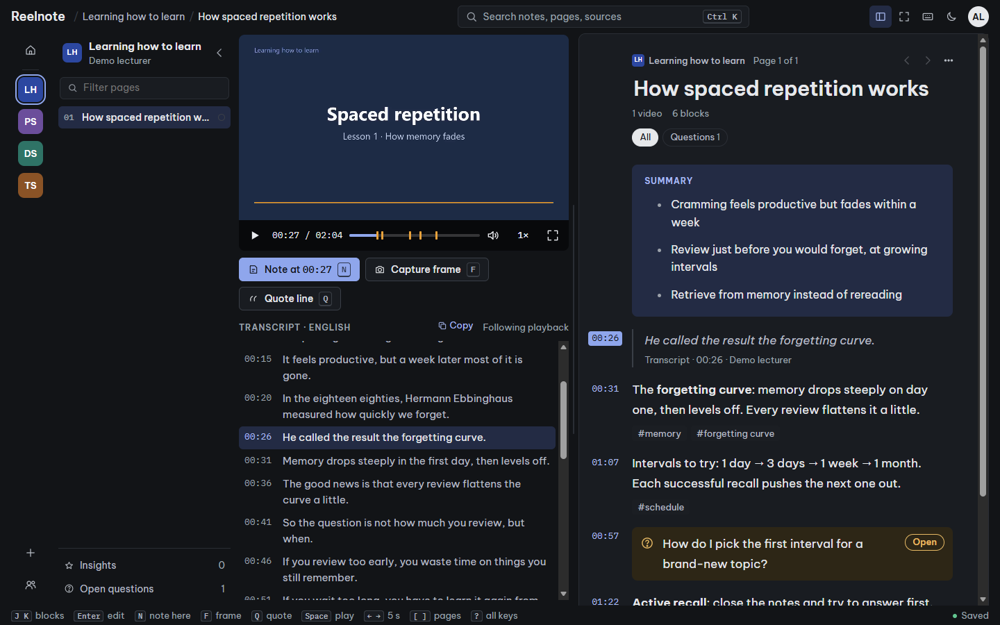
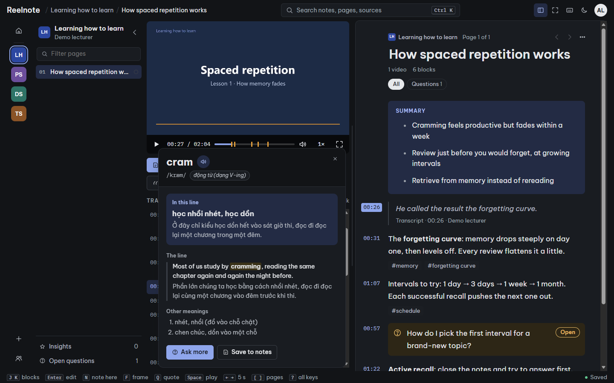
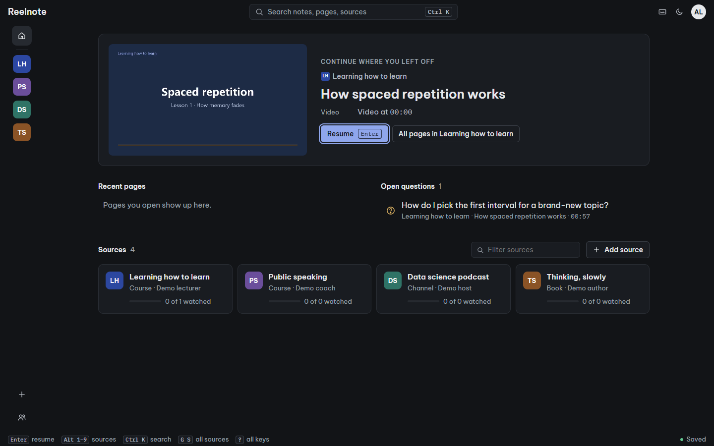
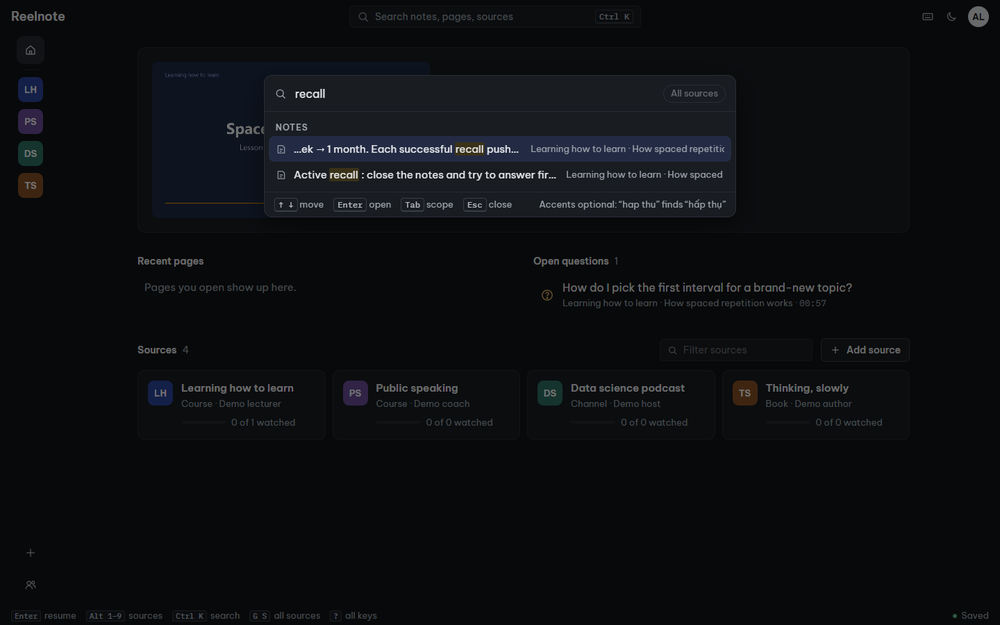

# Reelnote

**A self-hosted study desk for learning from video lectures.** Watch a lecture, read its transcript beside it,
and take notes that are stamped to the second, so every note plays the video from where it was written. Made
for courses, talks and any other video-heavy subject.

It runs on one PC. Friends open it in a browser over the home network or Tailscale and sign in; the owner
decides who can read or edit each source.



## What it does

- **Study desk.** Video player, live transcript and a notebook side by side. `N` writes a note at the current
  second, `Q` quotes the transcript line, `F` captures the video frame into a note. Notes keep time order.
- **Transcript from the video file.** The English (or Vietnamese) subtitle track is read straight out of the mp4
  in a worker thread: no separate subtitle files, no re-encoding.
- **Word lookup in context.** Select a word, phrase or sentence in the transcript and press **Look up**: what it
  means *in that line* (Vietnamese), IPA, part of speech, other meanings and the line translated. A listen
  button reads it aloud. **Ask more** opens a follow-up chat about it, and any answer can be saved as a note
  stamped at that line. Powered by Google Gemini with each user's own API key or a shared one; answers are
  cached so the same question is never asked twice.
- **A real notebook.** Block editor (Tiptap) with headings, summaries, quotes and open questions;
  images with crop and markup; tags, pins, insights by category, private annotations, undoable deletes.
- **Search** across sources, pages, notes, annotations and tags, accent-insensitive ("hap thu" finds "hấp thụ").
- **Works offline-ish.** Edits queue in the browser while the server is unreachable and replay when it is back.
- **Accounts and sharing.** Email + password, sessions, per-source read/write sharing, an owner admin page.
- **Installable** as an app window (PWA manifest), keyboard-first throughout.

## Screenshots

**Word lookup in context.** Select a word in the transcript: its meaning in that line, the line translated,
other meanings, and Ask more for a follow-up chat.



**Home** picks up where you stopped, with open questions across sources.



**Search** everything with Ctrl K, accents optional.



All screenshots use demo data made for this README: a generated sample lecture and made-up notes.

## Engineering highlights

- **Security by default.** Every learning route goes through one access module (SQL visibility scopes plus
  route guards); a test walks every route and expects 401 without a session, and an access matrix drives every
  rule end to end. Strict CSP with no inline script, CSRF header and origin checks, scrypt passwords, hashed
  session tokens, sign-in throttling keyed on the account, never trusting the client IP. See
  [docs/security.md](docs/security.md).
- **Outbound calls are contained.** Word lookup only sends text the viewer can already see, read on the server
  from the video itself; keys never leave the server and responses only ever show their last four characters.
- **Plain, testable layers.** Fastify + SQLite (better-sqlite3, WAL, numbered SQL migrations), services with
  explicit inputs, ~280 tests (Vitest) running against a throwaway data dir.
- **Careful media handling.** Range requests with ETags, path containment inside the library root (no links
  followed), mp4 box parsing for subtitle tracks and source links.
- **Operations.** Daily backups with image mirroring, log rotation, one-command setup and start scripts.

## Stack

| Part | Tech |
|---|---|
| Server | Node 24, TypeScript, Fastify 4, better-sqlite3, Drizzle (schema), Pino |
| Web | React 18, Vite 7, TypeScript, Tiptap 3, marked + DOMPurify |
| Tests | Vitest, Fastify inject, real mp4 fixtures |
| AI | Google Gemini API (`generateContent`, JSON output) for word lookup and follow-up chat |

## Layout

| Path | What |
|---|---|
| `server/` | Fastify API; it also serves the built web UI, on one port |
| `web/` | The web UI |
| `docs/` | [architecture](docs/architecture.md), [security](docs/security.md), [operations](docs/operations.md) |
| `scripts/` | Windows setup, start and shortcut scripts |

Data lives outside the repo, in `REELNOTE_DATA_DIR`: `reelnote.db`, `images/`, `logs/`, `backups/`. Videos stay in
their library folder, which Reelnote only reads.

## Run

```bash
pnpm install
pnpm build
pnpm user create --email you@example.com --name You --role owner
pnpm start
```

Open `http://localhost:3900` and sign in. Configuration comes from `.env` at the repo root (copy
`.env.example`). Word lookup keys are set in the app (account menu → Word lookup key), which also explains how
to get a free Gemini API key.

## Check

```bash
pnpm typecheck
pnpm lint
pnpm test
```

## Not done yet

- Transcripts come from the video's own subtitle track; there is no speech-to-text inside the app.
- Offline edits wait in localStorage, and only edits: creating a block or uploading an image needs the server.
- Save conflicts: the last write wins per block.

## License

[MIT](LICENSE)
